# Customer Support Agent — Amazon Bedrock AgentCore

An agentic AI customer-support application built with **Amazon Bedrock AgentCore** and **Strands Agents**. The project demonstrates how an AI agent can combine foundation-model reasoning with knowledge retrieval, persistent memory, backend integrations, browser interaction, and code execution.

## Overview

The agent supports several customer-service workflows:

* Order tracking through Gateway/MCP integrations
* Refund operations through backend services
* Product and loyalty information retrieval through a Knowledge Base
* Customer memory across sessions
* Loyalty-point and discount calculations using Code Interpreter
* Browser interaction using AgentCore Browser

## Architecture

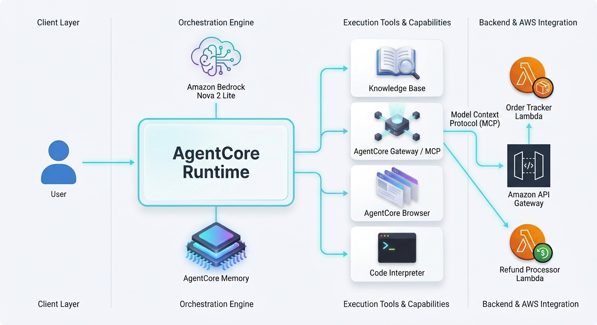

## AWS Console

Screenshots of the AWS services configured and used during development and testing are included for reference.

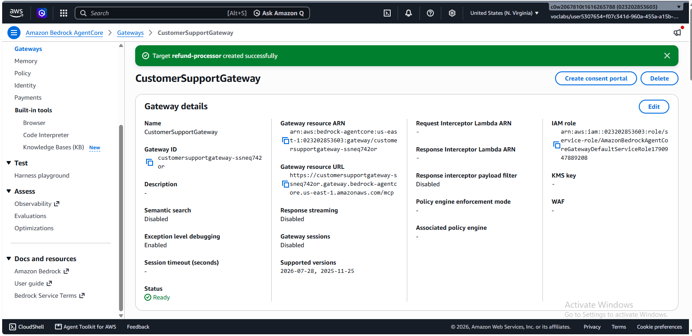

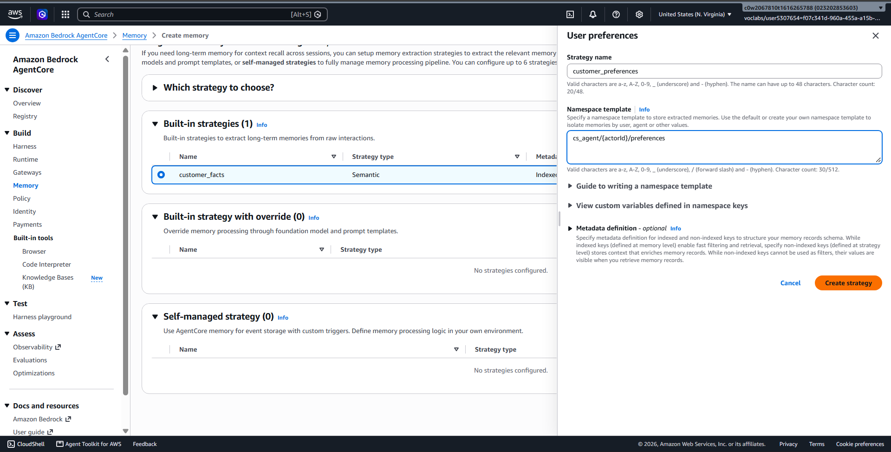

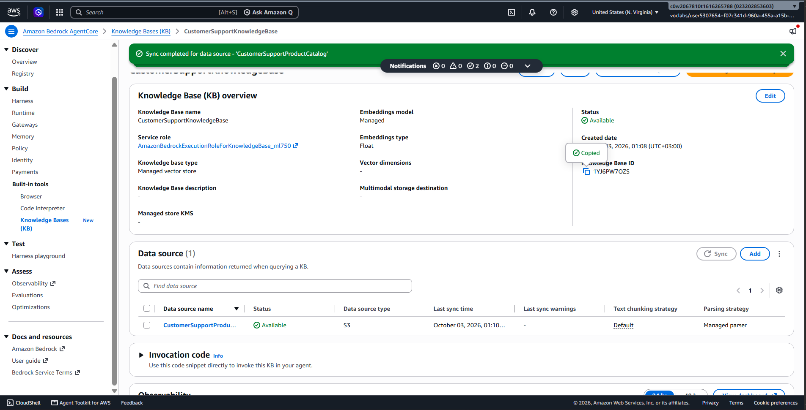

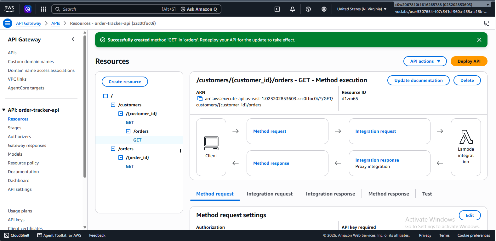

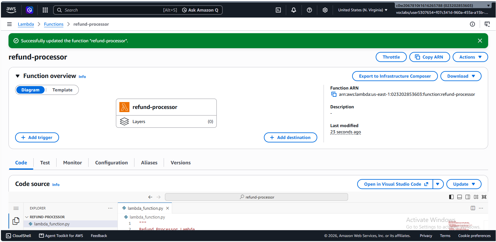

## Capabilities

| Test | Capability     | Demonstrates                               |
| ---- | -------------- | ------------------------------------------ |
| 1    | Order Tracking | Backend order lookup through Gateway/MCP   |
| 2    | Refund         | Refund operation through Gateway           |
| 3    | Knowledge Base | Product and loyalty information retrieval  |
| 4    | Memory         | Customer information across sessions       |
| 5    | Loyalty        | Code-based points and discount calculation |
| 6    | Browser        | External website interaction               |

## Technology Stack

* Python 3.13
* Amazon Bedrock
* Amazon Bedrock AgentCore
* Amazon Nova 2 Lite
* Strands Agents
* MCP
* AgentCore Memory
* AgentCore Gateway
* Amazon Bedrock Knowledge Base
* AgentCore Browser
* AgentCore Code Interpreter
* AWS Lambda
* Amazon API Gateway
* boto3
* uv

## Project Structure

```text
customer-support-agent/
├── main.py                         # AgentCore application and agent logic
├── product_catalog.txt             # Product and loyalty information for the Knowledge Base
├── pyproject.toml                  # Python dependencies and project configuration
├── .env.example                    # Example environment configuration
├── .gitignore                      # Files excluded from version control
├── lambda/
│   ├── lambda_schema               # API/Gateway tool schema definitions
│   ├── order_tracker.py            # Order tracking Lambda function
│   └── refund_processor.py         # Refund processing Lambda function
├── docs/
│   ├── architecture.jpg            # Agent architecture diagram
│   └── aws-console/                # AWS Console configuration screenshots
│       ├── gateway.png
│       ├── memory.png
│       ├── knowledge-base.png
│       ├── api-gateway.png
│       └── lambda.png
├── evidence/
│   ├── test1-order-tracking.txt    # Order tracking test output
│   ├── test2-refund.txt            # Refund processing test output
│   ├── test3-knowledge-base.txt    # Knowledge Base retrieval test output
│   ├── test4-memory-session-a.txt  # Memory creation/session A test output
│   ├── test4-memory-session-b.txt  # Cross-session memory retrieval test output
│   ├── test5-loyalty.txt           # Loyalty discount calculation test output
│   └── test6-browser.txt           # Browser tool test output
├── screenshots/
│   ├── test1-order-tracking.png    # Order tracking test screenshot
│   ├── test2-refund.png            # Refund processing test screenshot
│   ├── test3-knowledge-base.png    # Knowledge Base test screenshot
│   ├── test4-memory-session-a.png  # Memory session A screenshot
│   ├── test4-memory-session-b.png  # Memory session B screenshot
│   ├── test5-loyalty.png           # Loyalty calculation screenshot
│   └── test6-browser.png           # Browser test screenshot
└── reflection.md                   # Project reflection and lessons learned
```

* `main.py` — AgentCore application and agent tools
* `product_catalog.txt` — Knowledge Base source content
* `lambda/` — Backend Lambda integrations
* `docs/` — Architecture and AWS Console screenshots
* `evidence/` — Test execution output
* `screenshots/` — Test screenshots
* `.env.example` — Example environment configuration
* `reflection.md` — Project reflection

## Setup

### Prerequisites

* Python 3.13
* `uv`
* AWS CLI
* Configured AWS credentials
* Required AWS resources configured for the application

Install dependencies:

```bash
uv sync
```

Verify Python:

```bash
uv run python --version
```

Copy the example environment file and configure the required resource values:

```bash
cp .env.example .env
```

The environment configuration contains:

```env
AWS_REGION=us-east-1
GATEWAY_URL=
KB_ID=
MEMORY_ID=
```

Populate the resource-specific values in your local `.env` file. Do not commit `.env` to source control.

## Running Locally

The application accepts a JSON request containing a prompt, customer ID, and session ID:

```bash
uv run main.py '{"prompt": "Hello", "customer_id": "CUST-123", "session_id": "s1"}'
```

Example deployed invocation:

```bash
agentcore invoke '{"prompt": "Can you track order ORD-001?", "customer_id": "CUST-123", "session_id": "t1"}'
```

## Deployment

The project uses the AgentCore CLI for deployment.

Configure the application:

```bash
uv run agentcore configure \
  --entrypoint main.py \
  --name <your-agent-name> \
  --deployment-type direct_code_deploy \
  --runtime PYTHON_3_13 \
  --disable-memory
```

Deploy:

```bash
uv run agentcore deploy
```

`--disable-memory` is used because the project manages its pre-created AgentCore Memory resource directly.

## Testing & Evidence

### Test 1 — Order Tracking

[Evidence](evidence/test1-order-tracking.txt)

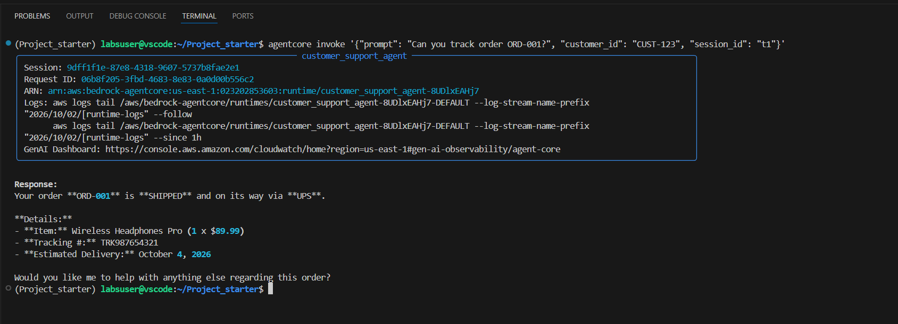

### Test 2 — Refund

[Evidence](evidence/test2-refund.txt)

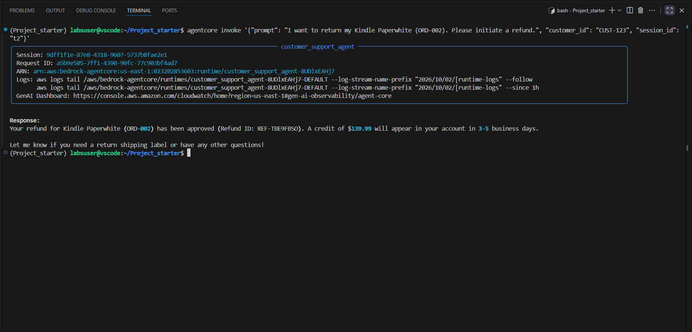

### Test 3 — Knowledge Base

[Evidence](evidence/test3-knowledge-base.txt)

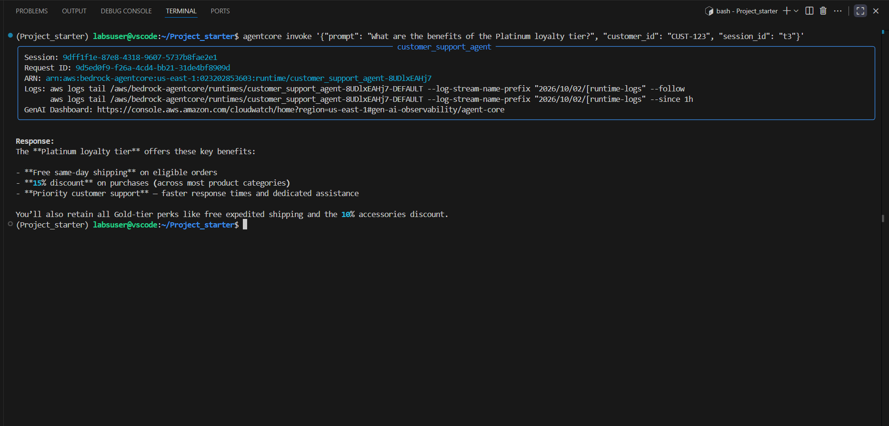

### Test 4 — Memory

Session A establishes customer information, while Session B verifies that the information can be retrieved across sessions.

[Session A Evidence](evidence/test4-memory-session-a.txt) · [Session B Evidence](evidence/test4-memory-session-b.txt)

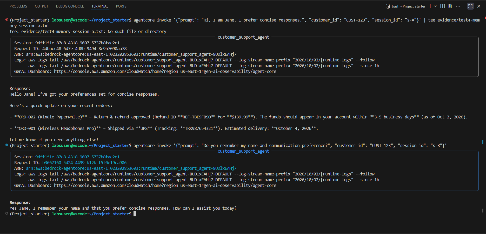

### Test 5 — Loyalty

Demonstrates loyalty-point redemption and tier-based discount calculation using Code Interpreter.

[Evidence](evidence/test5-loyalty.txt)

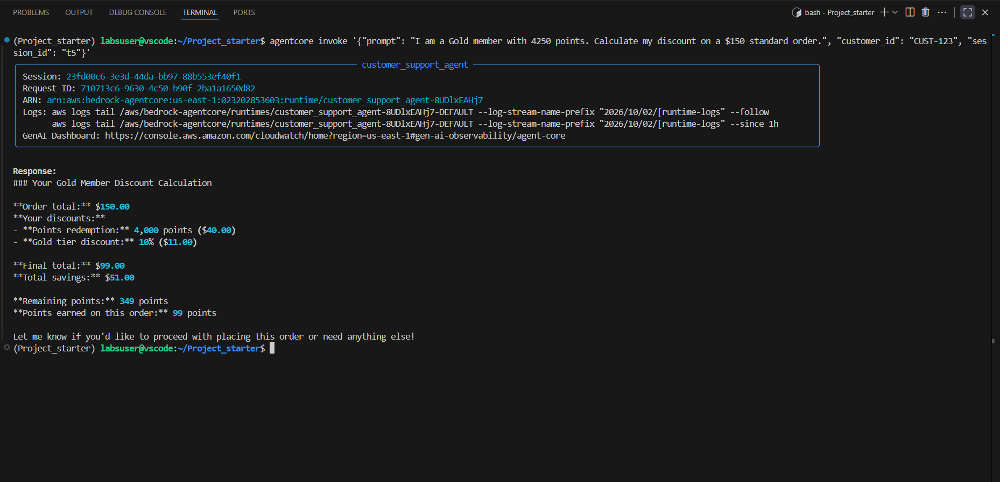

### Test 6 — Browser

Demonstrates AgentCore Browser navigating to an external website and retrieving its page title.

[Evidence](evidence/test6-browser.txt)

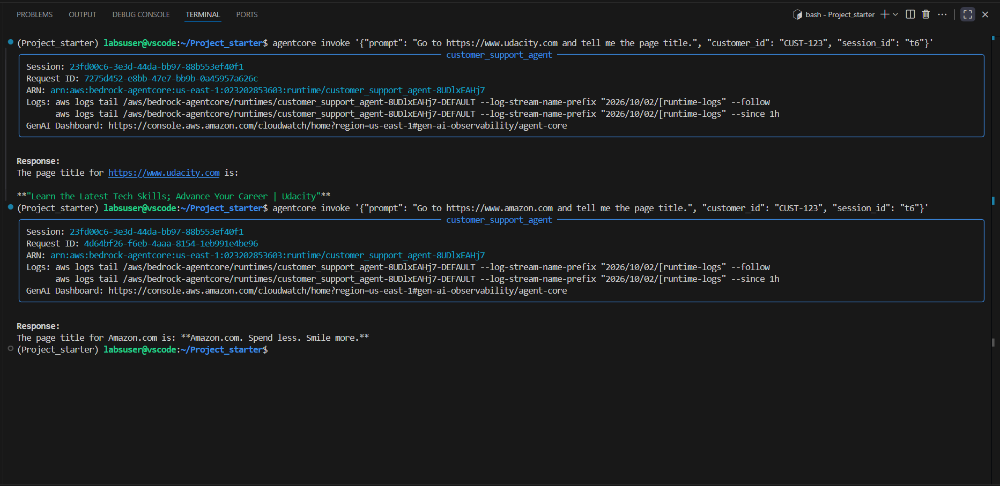

## Security

* Never commit AWS credentials, tokens, or secrets.
* Use IAM roles and least-privilege permissions.
* Keep sensitive configuration out of source control.
* Resource IDs and URLs are provided through environment variables rather than committed directly in source code.
* The lab Gateway uses the configured `NONE` authorizer; production deployments should use appropriate authentication and authorization.

## Reflection

[Read the project reflection](reflection.md)

## Author

**Fisiha Desta Wanore**
